

  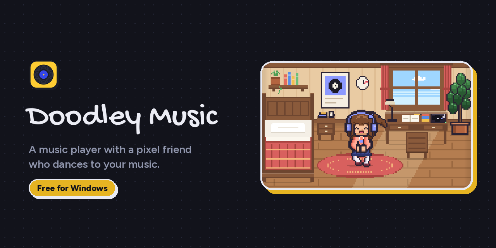

  
  
  
  

  

  Doodle lives in a cosy pixel room. They dance on the rug when your music plays, study at the desk when it's quiet, 
  and curl up in bed at night. Sometimes a cat drops by.

  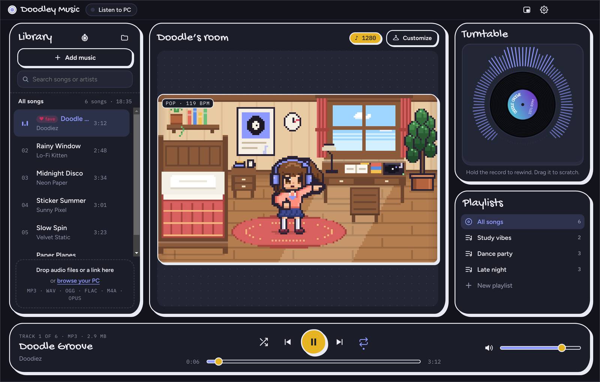

## ✨ Meet Doodle

<table>
  <tr>
    <td width="33%" align="center">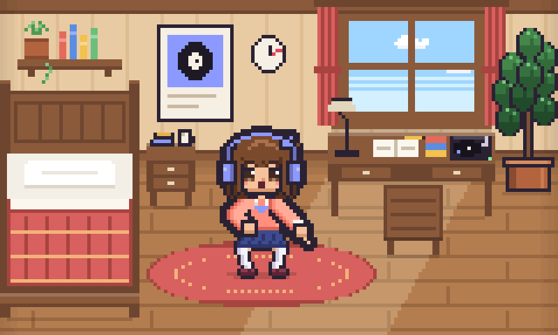 <b>Dances to your music</b> Different moves for lo-fi, pop, hip-hop, EDM and rock</td>
    <td width="33%" align="center">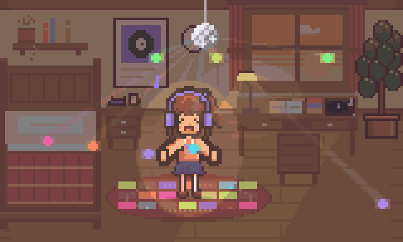 <b>Disco party</b> Lively songs drop a disco ball and the lights dance to the beat</td>
    <td width="33%" align="center">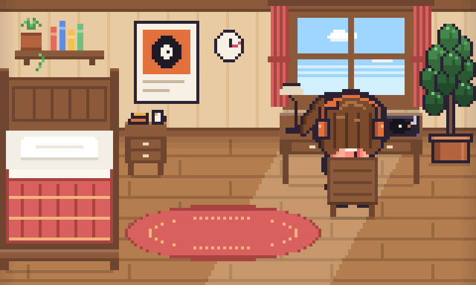 <b>A cat visits</b> Every few minutes a cat drops by. Click it to pet it</td>
  </tr>
  <tr>
    <td align="center">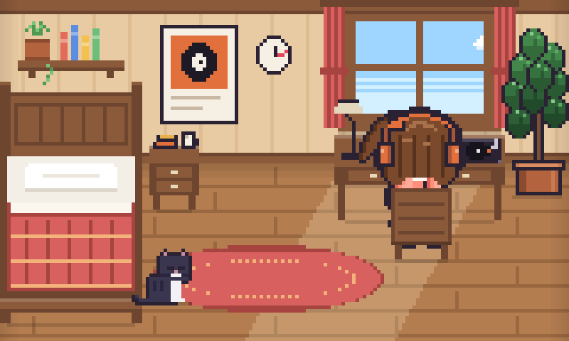 <b>Studies when it's quiet</b> Doodle walks to the desk when the music stops</td>
    <td align="center">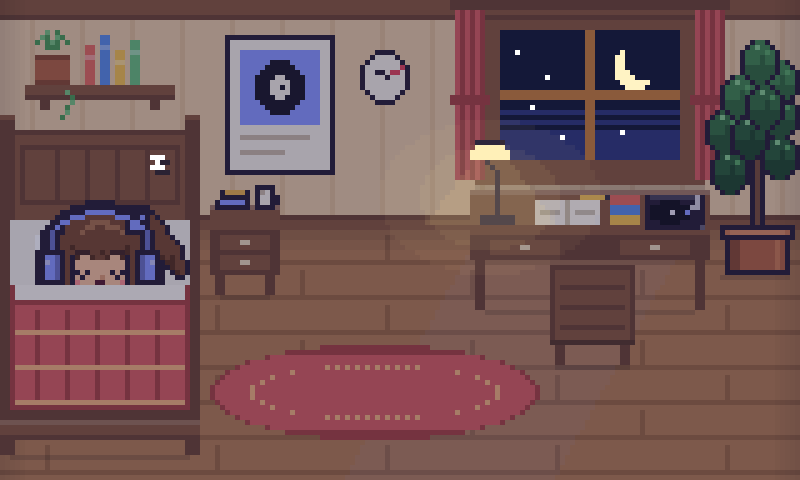 <b>Sleeps at night</b> The room follows your clock, from sunny mornings to starry nights</td>
    <td align="center"> 💬 <b>Talks to you</b> Over 200 pixel speech bubbles. Doodle picks a favourite song and asks for it when the music stops  </td>
  </tr>
</table>

## 🎨 Three styles

<table>
  <tr>
    <td width="33%" align="center"> <b>Doodle</b> Hand-drawn and playful</td>
    <td width="33%" align="center">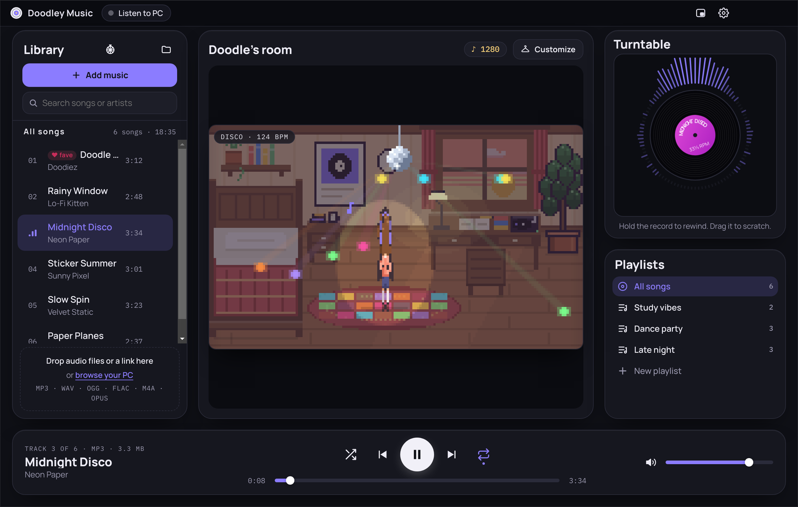 <b>Studio Glass</b> Sleek and glassy</td>
    <td width="33%" align="center">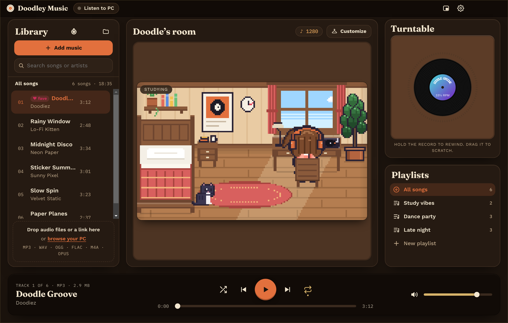 <b>Record Shop</b> Warm cream and walnut</td>
  </tr>
</table>

Every style comes in light and dark, with six accent colours.

## 🎵 Features

- **Add music your way:** drop in MP3, WAV, FLAC, OGG, M4A or OPUS files, or **paste a link** (YouTube, SoundCloud,
  Bandcamp and more) to save it as an MP3 with its title, artist and cover art
- **A real record to scratch:** drag the vinyl to scratch, hold it to spin it backwards
- **Listen to PC:** Doodle dances to anything your PC plays, from Spotify to games
- **Discord status:** show what you're listening to on your Discord profile, with Doodle's picture
- **Song roulette:** can't choose? Spin a wheel of your songs
- **Customise Doodle:** earn notes while you listen and spend them on outfits
- **Playlists, search and renaming**, crossfade, vinyl crackle, a mini player and your keyboard's media keys
- **Updates itself kindly:** a small note tells you when a new version is out

## 📸 Screenshots

<table>
  <tr>
    <td width="68%">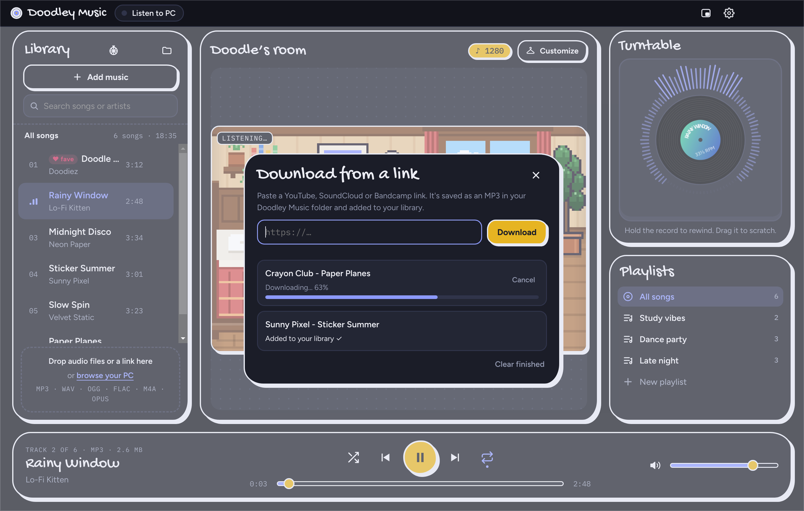</td>
    <td width="32%" rowspan="2" align="center">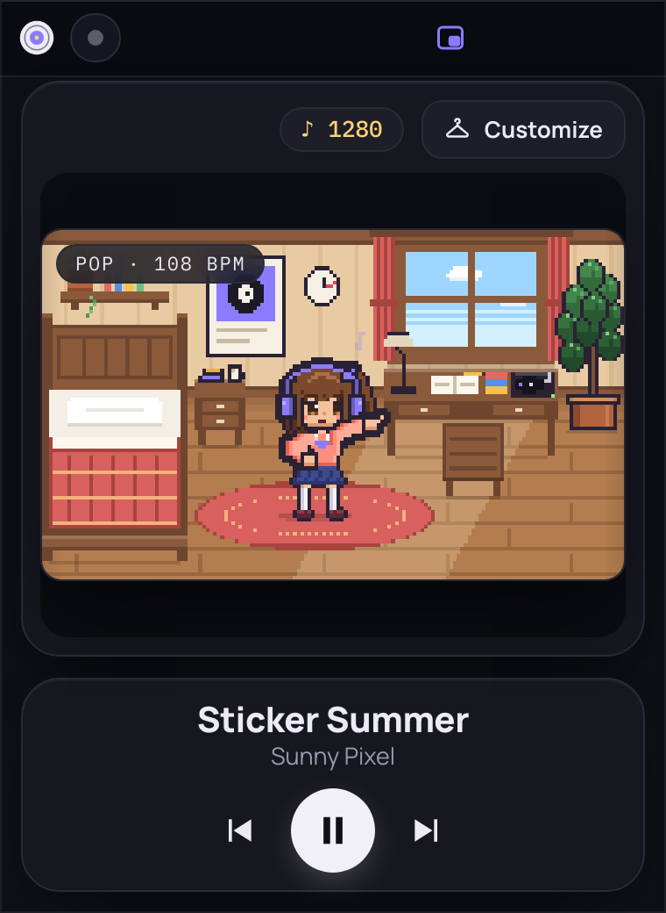 <b>Mini player:</b> a small window that stays on top</td>
  </tr>
  <tr>
    <td><b>Download from a link:</b> paste, drag or right-click → Paste and download</td>
  </tr>
  <tr>
    <td colspan="2">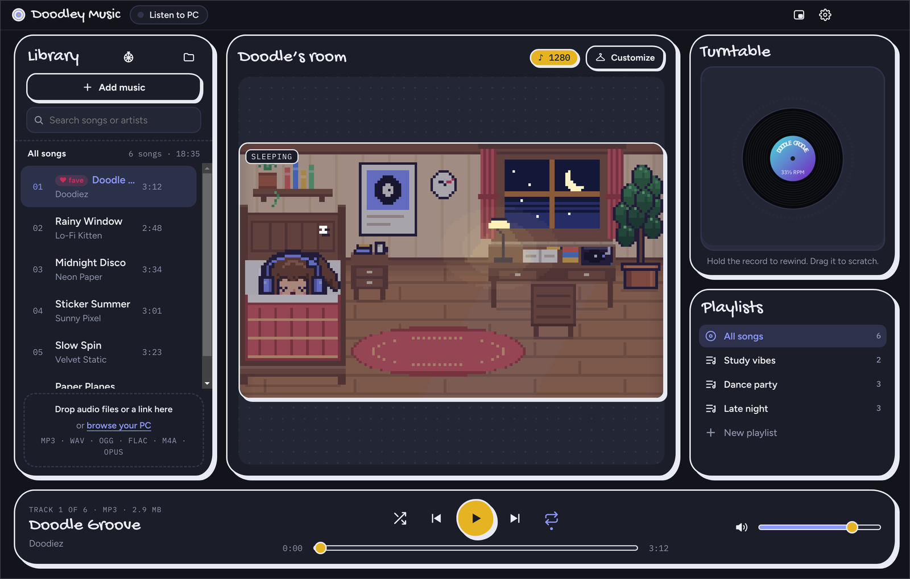 <b>Night time:</b> the room dims, the desk lamp glows and Doodle goes to bed</td>
  </tr>
</table>

## ❓ FAQ

<b>Windows says "Windows protected your PC". Is it safe?</b>

 
Yes. Windows shows this for apps from small creators that haven't paid for a code-signing certificate.
Click <b>More info → Run anyway</b>.

<b>Is it really free?</b>

 
Yes. No ads, no account, no subscription.

<b>Does it collect any data?</b>

 
No. Doodley Music doesn't collect anything about you or your music. It only goes online to check for a new version,
fetch its download tools and download the links you give it. "Listen to PC" only listens; nothing is recorded or sent.

<b>Where are my songs saved?</b>

 
In <code>Music\Doodley Music</code>. Settings, playlists and Doodle's outfits are kept in <code>%APPDATA%\Doodley Music</code>,
so they stay when you update.

<b>How do updates work?</b>

 
The app checks once a day and shows a small note with a <b>Download</b> button when a new version is out.
Install it over the old one and everything is kept. You can check by hand in Settings → About.

<b>Why does the first link download take a while?</b>

 
The first time, Doodley Music fetches the free tools it needs (yt-dlp, FFmpeg and Deno, about 150 MB, once).
After that, downloads start straight away. Only download music you own or have permission to download.

<b>Is there a Mac or Linux version?</b>

 
Not yet. Doodley Music is for Windows 10 and 11.

## 💌 Feedback

Found a bug or have an idea? [Open an issue](https://github.com/Doodiez/doodley-music/issues/new/choose). It only takes a minute.

 

  © 2026 Mior Iman Haiqal. All rights reserved. Free to download and use. 
  Only download music you own or have permission to download.

